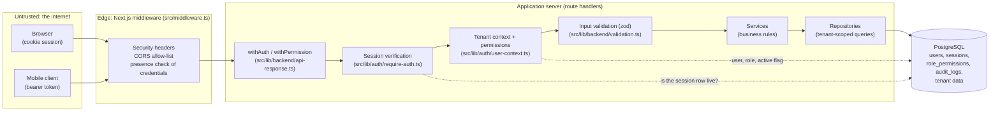
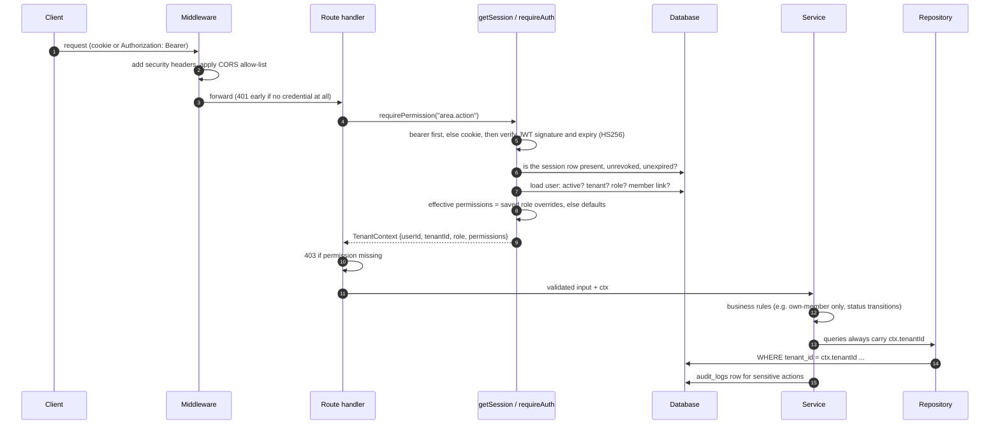
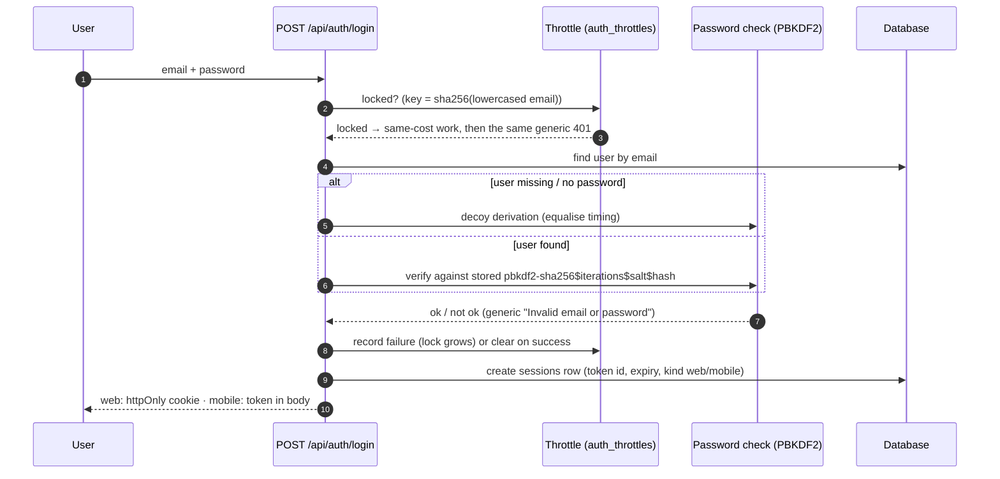
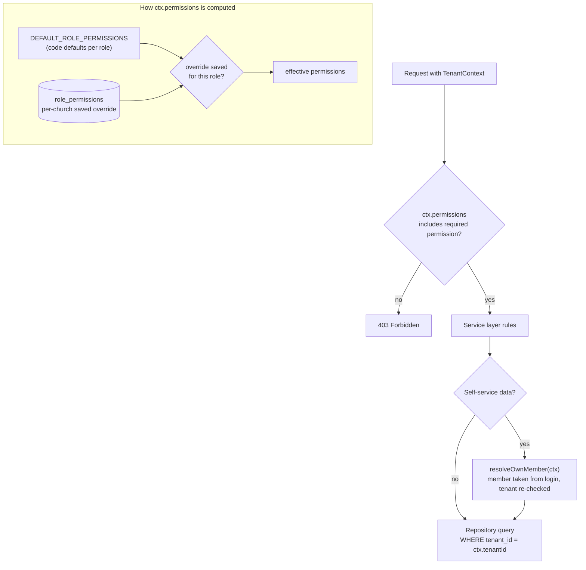

# Security Architecture

A guide for reviewing how this application protects its data. Every statement below
points at the code that implements it, so you can check it rather than trust it.
Diagrams are Mermaid and render on GitHub.

> **Scope of this edition.** This is a trimmed copy of a larger private product. The
> enforcement code (sessions, tenant isolation, permission checks) is complete. The
> Settings → *Access and roles* screen and its API (the admin UI for editing roles) are
> **not included**, and several feature areas are placeholders. See the README.

## 1. Threat model in one paragraph

A multi-tenant church CRM. It stores personal data about members and families, and
sensitive pastoral data (prayer requests, shepherding notes). Users are staff (admins,
pastors, leaders, ushers) and members. The main risks are: one church reading another's
data, a member reaching staff data, stolen or shared sessions, password guessing, and
private prayer content leaking to the wrong audience.

## 2. System and trust boundaries



Trust rule: **the middleware is an early filter, not the security boundary.** The
boundary is the route handler wrapper (`withAuth` / `withPermission`), which verifies
the session against the database and checks the permission before any business code
runs. The middleware only checks that *some* credential is present.

## 3. Request lifecycle (authenticated API call)



Key properties:
- **Tenant and role come from the database, never from the token or the request.**
  `resolveTenantContext` is the only constructor of a `TenantContext`
  (`src/lib/auth/user-context.ts`). The JWT's `role` field is not trusted for decisions.
- **Bearer wins over cookie** when both are sent, so identity is never ambiguous
  (`getSession`, `src/lib/auth/require-auth.ts`).
- **Revocation is real:** a valid signature is not enough; the `sessions` row must be
  live (`verifySessionIsLive`, `src/lib/auth/session.ts`).

## 4. Authentication and session lifecycle



| Control | Behaviour | Where |
|---|---|---|
| Password hashing | PBKDF2-HMAC-SHA256 via WebCrypto, per-user salt, parameters stored in the hash string so the cost can be raised later; `needsRehash` flags weaker hashes so they can be upgraded | `src/lib/auth/password.ts` |
| Timing / enumeration | Decoy derivation for unknown users and for locked accounts; one generic error message (a lock is not revealed to the caller) | `password.ts` (`equalizeTiming`), `src/app/api/auth/login/route.ts` |
| Brute force | Per-account throttle in the database: 5 failures per 15 min, then a 5 minute lock that doubles per further failure up to 1 hour. Keyed on a hash of the email, so no plaintext addresses are stored. No IP limiting by design (shared mobile NAT) | `src/lib/auth/throttle.ts`, `src/lib/backend/config.ts` |
| Web session | JWT (HS256) in an `httpOnly`, `sameSite=lax`, `secure` (on HTTPS) cookie, 7 day expiry. The token is never in a JS-readable response body | `src/lib/auth/session.ts` |
| Mobile session | Bearer token, 1 hour access token refreshed against a longer session | `session.ts`, `src/app/api/auth/refresh` |
| Logout / revoke | Session row marked revoked; verification consults it | `session.ts`, `src/app/api/auth/logout` |
| Change password | Authenticates the caller itself | `src/app/api/auth/change-password` |

## 5. Authorization: roles, permissions, tenant isolation



- **Roles:** super_admin, admin, pastor, leader, usher, member. Members start with no
  feature access beyond their own conversation (`messages.self`); a church grants more.
  Defaults: `DEFAULT_ROLE_PERMISSIONS` in `src/lib/auth/user-context.ts`. The permission
  list lives in `src/lib/auth/permission-catalog.ts`, and a test enforces that every
  permission is listed.
- **Permissions are named capabilities** (for example `prayer_wall.moderate`,
  `seating.reserve`), checked per route with `withPermission("…")`.
- **Tenant isolation:** repositories take `tenantId` from the server-resolved context
  and put it in every query. Self-service code resolves the member behind the login and
  re-checks that it belongs to the same tenant (`src/lib/backend/services/own-member.ts`).
  Tests: `src/lib/auth/tenant-isolation.test.ts`.
- **Privacy rules in code, not UI:** the prayer wall releases an author's name only when
  they chose to show it; the projection is a single function (`toWallItem`,
  `src/lib/prayer-wall/rules.ts`), so no caller can pick fields and leak a name.
  Nothing is visible until a moderator approves it.
- **Time-boxed state without a job:** seat holds expire by comparing a stored time with
  the clock at read time (`src/lib/seating/reservation-rules.ts`), so there is no
  scheduler to fail.
- **Not included here:** the admin API that edits roles and approves role requests (and
  the guardrails that stop people granting above their own level). Enforcement of the
  saved results is included (`role-permission-store.ts`).

## 6. Other layers

| Layer | What it does | Where |
|---|---|---|
| Security headers | `X-Content-Type-Options`, `X-Frame-Options: DENY`, `Referrer-Policy`, `Permissions-Policy` | `src/middleware.ts` |
| CORS | Only the site's own origin and origins listed in `CORS_ALLOWED_ORIGINS` get credentialed access; others get no CORS headers | `src/middleware.ts` |
| Input validation | zod schemas in `validation.ts`, applied in the route or in the service; invalid input is rejected with a 400 | `src/lib/backend/validation.ts` |
| Errors | Typed errors map to status codes (401, 403, 400, 404, 409); see gap 10 for unexpected errors | `src/lib/backend/errors.ts`, `api-response.ts` |
| Audit trail | `audit_logs` rows (who, what, before/after values) written by services for sensitive actions. The table has IP and user-agent columns, but services do not currently fill them | `src/lib/backend/services/base-service.ts`, `prisma/schema.prisma` |
| Secrets | Required via environment (`JWT_SECRET` fails fast if missing); none are in the repository | `src/lib/backend/config.ts`, `.env.example` |

## 7. Known gaps and open questions (please challenge these)

Listed deliberately, so your review time goes where it helps most.

1. **Middleware route list is not deny-by-default.** `PROTECTED_API_ROUTES` names
   prefixes, and newer areas (announcements, prayer wall, seating, families, talent…)
   are not in it. They are still protected, because each handler uses
   `withAuth`/`withPermission` (the five routes without a wrapper are health, login,
   refresh, logout and change-password, which authenticate or are public by design).
   A deny-by-default allow-list would remove the dependence on that convention.
2. **No CSRF token.** Cookie sessions rely on `SameSite=Lax`, the CORS allow-list and
   JSON bodies. An `Origin` check on state-changing requests would add a layer.
3. **No Content-Security-Policy.** `X-XSS-Protection` is set but obsolete.
4. **Cache windows.** Session liveness is cached for 30 s, and user context and role
   overrides for 60 s, per server instance. A revocation or role change can take up to
   that long to apply.
5. **JWT uses one shared HS256 secret** with no rotation scheme.
6. **Rate limiting covers login only** (per account). Other endpoints are unthrottled.
7. **Hash cost on the deployed runtime.** OWASP suggests 600,000 PBKDF2 iterations; the
   default is 600,000, but the Cloudflare Workers CPU limit forced a lower value in the
   pilot deployment. Old hashes verify under their own parameters.
8. **Pilot conveniences exist in code:** demo accounts, a demo login flag
   (`DEMO_LOGIN_ENABLED`), a simulated clock (`ENABLE_DEMO_CLOCK`), and a development-only
   auth bypass header that is ignored unless `NODE_ENV === "development"`. These must be
   off before real use.
9. **Bearer tokens (mobile).** The member app keeps its bearer token in browser storage
   (see section 8), and the server cannot clear it, only revoke the session behind it.
10. **Fixed since the first version of this guide:** unexpected errors used to return the
    raw error message to the client. In production they now return a fixed message
    (`errorResponse`, `src/lib/backend/api-response.ts`); the real error is logged only.
11. **Fixed since the first version of this guide:** `POST /api/realtime/publish` used to
    need only a login, so any member could publish events. It now requires the
    `attendance.create` permission, accepts only the `attendance.check_in` event and caps
    the payload (`src/app/api/realtime/publish/route.ts`, with tests).

## 8. Mobile app (review edition)

The member app lives at `/mobile` (view it in a phone-width window or on a phone on the
same network). Here it is limited to: sign-in, Home, Community → Prayer wall, and
Profile. Check-in, seating, care requests, events, ideas, groups, talent and
notifications are shown but locked, and their code is not included.

| Topic | Behaviour | Where |
|---|---|---|
| Sign-in | Email and password only, sent to `POST /api/auth/mobile/login`. Same throttle, decoy hashing and generic error as the web login (section 4) | `src/app/api/auth/mobile/login/route.ts` |
| Token transport | Bearer token in the response body (no cookie). Sent as `Authorization: Bearer …` on every call | `src/lib/mobile-app/api-client.ts`, `src/lib/auth/require-auth.ts` |
| Lifetime | Short access token (`mobileAccessTokenExpiry`, about 1 hour by default). The server has a refresh endpoint (`/api/auth/refresh`), but the mobile client in this edition does not call it, so after expiry the member signs in again | `src/lib/auth/session.ts`, `src/app/api/auth/refresh` |
| Revocation | Logout or "sign out" revokes the session row; a revoked token fails the live-session check (cached up to 30 s) | `session.ts`, `src/app/api/auth/logout` |
| Server checks | Identical to the web: tenant and role from the database, permission per route, self-service limited to the caller's own member record | sections 3 and 5 |
| Client storage | The token is kept in `sessionStorage` and `localStorage` so the app survives a reload. This is the usual trade-off for a bearer token: a script injected into the page could read it (see gap 3: no CSP). The web CRM avoids this with an `httpOnly` cookie | `api-client.ts` |

What is not in this edition: Google sign-in and sign-up, push-notification
registration, the Android/iOS wrappers, offline caching of private data beyond what the
included screens need, and the music/welcome screen.

## 9. Suggested review path (about 1 hour)

1. `src/middleware.ts` (what it does and does not enforce)
2. `src/lib/auth/require-auth.ts` → `session.ts` (token + live-session checks)
3. `src/lib/auth/user-context.ts` (how tenant and permissions are resolved)
4. `src/lib/auth/password.ts`, `throttle.ts`, `src/app/api/auth/login/route.ts`
5. One feature end to end: `src/app/api/prayer-wall/` → `prayer-wall-service.ts` →
   `prayer-wall-repository.ts` → `src/lib/prayer-wall/rules.ts`
6. Tests that document the guarantees: `src/lib/auth/*.test.ts`
   (tenant isolation, session lifecycle, throttle, authorization, password).

Run the checks:

```bash
TZ=Africa/Cairo npx vitest run
npx tsc --noEmit -p .
```
